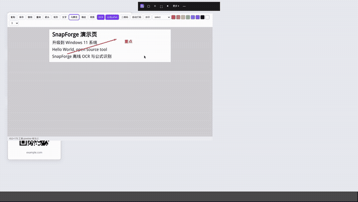

# BestSnap

**最好用的截图神器，OCR、LaTeX公式识别一键搞定**

[⬇️ 下载安装包 / Download installer](https://github.com/xinren1230/BestSnap/releases/latest/download/BestSnap-Setup-1.1.1.exe) · [🎬 演示视频 / Demo video](docs/demo.mp4)

[](docs/demo.mp4)

> 点击上图播放完整演示视频（约 56 秒）。Click the animation to watch the full demo (~56 s).

---

## 中文

### 功能

- 📸 **截图**：框选区域、窗口、全屏；常驻顶部工具栏，一点就用
- ✏️ **标注**：箭头、矩形、文字，复制或保存 PNG
- 🔤 **OCR 文字识别**：中英文混排一键提取文字（PP-OCRv4）
- ∑ **公式转 LaTeX**：截一下公式，直接得到 LaTeX 代码并实时渲染预览
- 🔳 **二维码 / 条码识别**：框一下，链接马上出来
- 🎥 **录屏**：框选区域 / 单显示器 / 全部显示器 / 窗口；控制条暂停；MP4（H.264+AAC）或 GIF。先写入临时文件，完成窗口可预览、剪辑、转写、摘要，再另存
- 🎙️ **录音**：麦克风、系统声音（WASAPI 环回）或混合，WAV / MP3，实时电平；工具栏「录制」菜单可选屏幕 / 音频 / 仅转写
- 📝 **仅转写（不保存音频）**：滚动 Whisper 字幕 + 带时间戳的转写；音频只在内存中，停止后可复制 / 保存 txt、srt 并摘要
- 🕘 **截图历史**：自动保存，随时找回

### 下载

- **Windows**（Windows 10/11 x64）当前版本 **1.1.1**：
  - [⬇️ 直接下载安装包 BestSnap-Setup-1.1.1.exe](https://github.com/xinren1230/BestSnap/releases/latest/download/BestSnap-Setup-1.1.1.exe)
  - 或打开 [Releases 页面](https://github.com/xinren1230/BestSnap/releases/latest) 查看校验文件与说明
  - 一键安装，所有依赖（运行时、OCR 和公式模型）已打包在内，已用 Certum 代码签名
- **Linux / macOS**：暂无原生桌面安装包；Linux 可从源码运行，见下方“从源码构建”。

### 隐私

所有识别都在本地完成：Windows 版在你的电脑上离线运行。**截图和图片不会上传到任何服务器。**

### 从源码构建

**Windows 版**（`src/`，WPF / .NET 8，需在 Windows 上构建）：

1. 安装 [.NET 8 SDK](https://dotnet.microsoft.com/download/dotnet/8.0)（x64）。打安装包还需 Inno Setup 6.5+（`winget install JRSoftware.InnoSetup`）。
2. 在 PowerShell 中，于仓库根目录运行：

```powershell
dotnet test src\BestSnap.Tests\BestSnap.Tests.csproj -c Release   # 单元测试
.\build.ps1                  # 生成 publish\BestSnap.exe（需 .NET 8 Desktop Runtime）
.\build.ps1 -SelfContained   # 免运行时的单文件版本
.\build.ps1 -Installer       # 生成 dist\BestSnap-Setup-<版本>.exe 一键安装包
```

可选 `-SignThumbprint <证书指纹>` 做代码签名；仓库里不含任何证书或密钥。

**Linux 版**（`node/`，Node.js 20+ / Electron，Ubuntu / Debian x64，X11）：

```bash
cd node
bash scripts/setup.sh   # 安装 apt 依赖、npm ci、拷贝 OCR 模型、下载并校验公式模型
npm test
npm start               # 启动 Electron 工具栏
```

更多说明（命令行用法、AppImage 打包）见 [node/README.md](node/README.md)。

### 许可

BestSnap 使用 [Apache-2.0](LICENSE) 许可，© 2026 Chen Xinren。第三方组件（PP-OCRv4 / RapidOCR、pix2text-mfr、ONNX Runtime、KaTeX、ZXing 等）保留各自许可，见 [THIRD_PARTY_NOTICES.md](THIRD_PARTY_NOTICES.md)。

---

## English

**The best screenshot tool — OCR and formula-to-LaTeX in one click.**

### Features

- 📸 **Capture** a region, a window or the full screen from an always-on top toolbar
- ✏️ **Annotate** with arrows, rectangles and text; copy or save as PNG
- 🔤 **OCR**: extract mixed Chinese/English text (PP-OCRv4)
- ∑ **Formula → LaTeX**: snip an equation and get LaTeX code with a live preview
- 🔳 **QR / barcode** decoding
- 🎥 **Screen recording**: region, one monitor, all monitors, or a window; pause from the control bar; MP4 (H.264+AAC) or GIF. Stop writes a temp file; the completion window has preview, Trim, Transcribe, Summarize, then Save As
- 🎙️ **Audio recording**: microphone, system loopback, or mixed; WAV / MP3 with live meters. The toolbar Recording menu offers screen, audio-only, and transcribe-only
- 📝 **Transcribe only (no audio saved)**: live Whisper captions and a timestamped transcript; audio stays in memory; on stop you can copy / save .txt .srt and summarize
- 🕘 **Capture history**, saved automatically

### Download

- **Windows** (10/11, x64), current version **1.1.1**:
  - [⬇️ Direct download BestSnap-Setup-1.1.1.exe](https://github.com/xinren1230/BestSnap/releases/latest/download/BestSnap-Setup-1.1.1.exe)
  - Or open the [Releases page](https://github.com/xinren1230/BestSnap/releases/latest) for the checksum and notes
  - One-click installer with every dependency (runtime, OCR and formula models) bundled, Certum code-signed, SHA256 on the release page
- **Linux / macOS**: no native desktop installer yet; Linux can run from source, see *Build from source* below.

### Privacy

Everything runs locally: the Windows app works offline on your PC. **Your screenshots and images are never uploaded.**

### Build from source

**Windows** (`src/`, WPF / .NET 8, build on Windows):

1. Install the [.NET 8 SDK](https://dotnet.microsoft.com/download/dotnet/8.0) (x64). The installer build also needs Inno Setup 6.5+ (`winget install JRSoftware.InnoSetup`).
2. In PowerShell at the repository root:

```powershell
dotnet test src\BestSnap.Tests\BestSnap.Tests.csproj -c Release   # unit tests
.\build.ps1                  # publish\BestSnap.exe (needs the .NET 8 Desktop Runtime)
.\build.ps1 -SelfContained   # single-file build, no runtime needed
.\build.ps1 -Installer       # dist\BestSnap-Setup-<version>.exe one-click installer
```

Optional `-SignThumbprint <cert thumbprint>` signs the output; no certificates or keys are stored in the repo.

**Linux** (`node/`, Node.js 20+ / Electron, Ubuntu / Debian x64, X11):

```bash
cd node
bash scripts/setup.sh   # apt deps, npm ci, OCR models, formula model download with SHA-256 check
npm test
npm start               # launches the Electron toolbar
```

See [node/README.md](node/README.md) for CLI usage and AppImage packaging.

### License

BestSnap is licensed under [Apache-2.0](LICENSE), © 2026 Chen Xinren. Third-party components (PP-OCRv4 / RapidOCR, pix2text-mfr, ONNX Runtime, KaTeX, ZXing, …) keep their own licenses; see [THIRD_PARTY_NOTICES.md](THIRD_PARTY_NOTICES.md).
